# FalconPlan

[](https://github.com/Leo-7GOAT/FalconPlan/actions/workflows/software.yml)
[](https://github.com/Leo-7GOAT/FalconPlan/actions/workflows/ros2.yml)

自己搭的一套阿克曼规控：横向控制、Frenet Lattice、ST 速度规划、IDM 行为、相机占栅。仿真在本机 CARLA 0.9.15 上按场景重跑过；实车是 WHEELTEC R550，树莓派 4B 跑 ROS2 Humble。规划节点只发 `/cmd_vel`，真正写串口的是 `chassis_bridge`。

更细的实验记录在 [docs/VEHICLE_ONBOARD.md](docs/VEHICLE_ONBOARD.md)。代码在 `planning/`、`control/`、`behavior/`、`onboard/`。

## 车上怎么连的

整车、树莓派、以及树莓派和底盘板的接法：

<p>
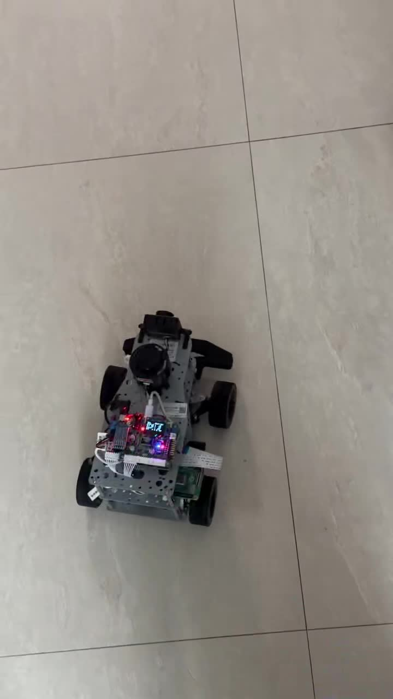
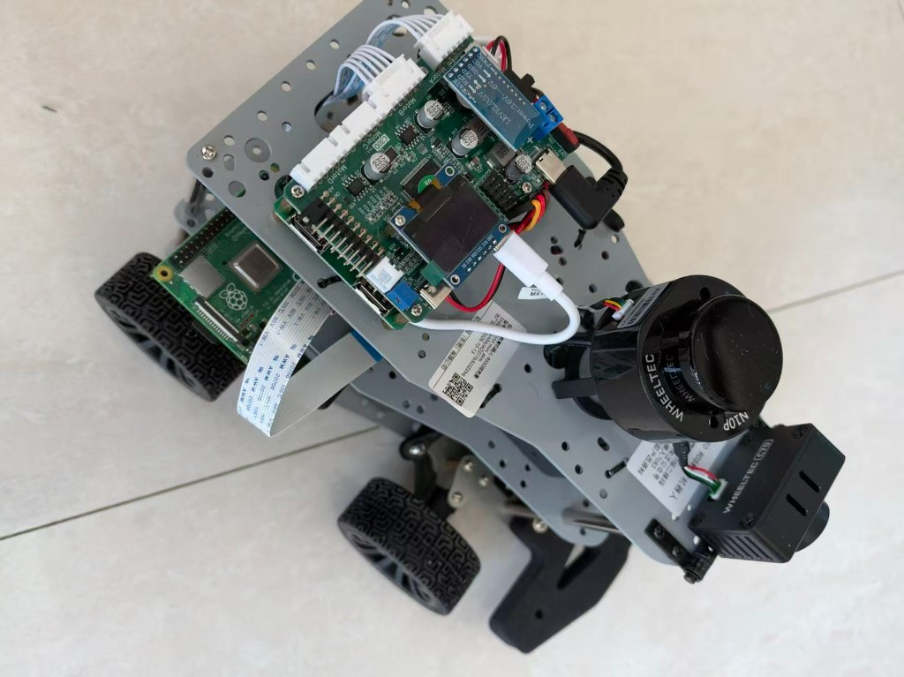
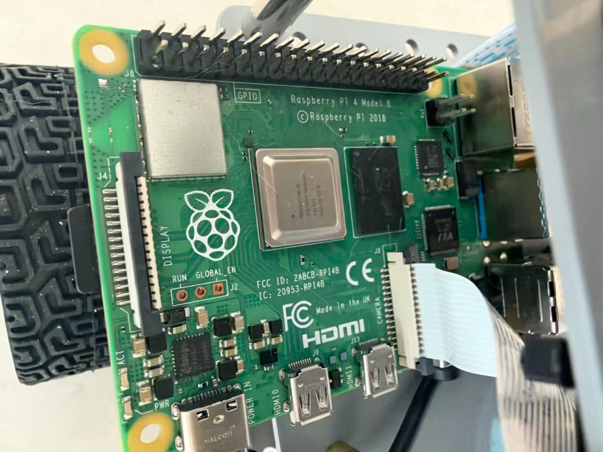
</p>

从上往下看：前头是 C70 相机和 N10 雷达，中间是 C30D 控制板（STM32），左边那块绿板是树莓派 4B，CSI 排线接到板载 Camera 口，白线 USB 把树莓派和底盘板连在一起。

| 线 | 接到哪 | 程序里用不用 |
|---|---|---|
| C30D 的 5Vout → 树莓派 | 给派供电 | 用。墙插和 5Vout 不能同时接 |
| 树莓派 USB → 沁恒串口 → STM32 | 底盘速度指令 / 反馈 | 用。`/dev/serial/by-id/usb-WCH.CN_USB_Single_Serial_0002-if00`，115200 8N1 |
| 树莓派 USB → C70 | 前视 640×480 MJPEG | 用。`/dev/video2`，判断前方有没有盒子 |
| 树莓派 CSI → Camera V2 | 排线相机 | 内核认得到，这套 demo 没用它认缝 |
| 另一路沁恒串口 → N10 雷达 | 距离能读 | 这套 demo 没用雷达 |

底盘只吃速度帧，11 个字节：`0x7B`，然后 vx、vy=0、wz 三个大端 int16（单位 mm/s 和 mrad/s），异或校验，`0x7D` 结尾。正的 wz 是向左，这个方向拿录像对过。反馈大约 20 Hz、24 字节。位姿只用后轮编码的 vx、wz 往前积分，陀螺零偏太大，没用。

规划器不直接碰串口。退出时桥节点先发大约 6 秒零速。这车 USB 拔了不会自己停，人要站在电源开关旁边。电压低于 10.8 V 就该充，充电的时候别开车。

## 程序怎么转一圈

车上两个 ROS2 节点塞在同一个进程里，但中间走的是真话题，不是函数对函数硬调。

1. `chassis_bridge` 独占串口。读到底盘反馈，积成位姿，发 `/odom` 和 `/voltage`。
2. `lattice_planner` 订 `/odom`。同时从 `/dev/video2` 抠前方一块 ROI：够暗就当有盒子，够亮且对比低就当空。
3. 有盒子：状态机先等一下，再走 Lattice 左绕。盒子拿走了：贴着砖缝直行。
4. Lattice 给出一条横向路径，ST 图上做 DP，再用 QP 把速度抹顺，纵向 MPC 跟速度，横向 MPC 跟路径。
5. 算完只发 `/cmd_vel`（`linear.x` 是 vx，`angular.z` 是 ω）。桥节点把它翻译成上面那 11 字节，写给 STM32。
6. 周期 50 ms。限幅：速度 0.15 m/s，舵角 0.38 rad，角速度 0.30 rad/s。

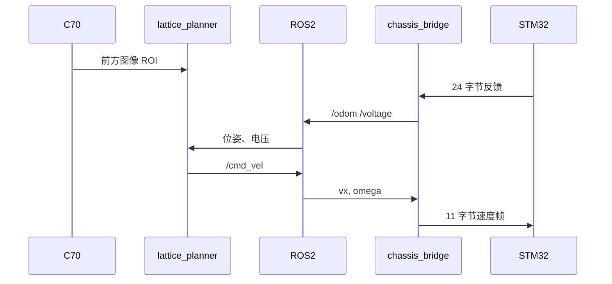

| 话题 | 类型 | 谁发给谁 |
|---|---|---|
| `/cmd_vel` | `geometry_msgs/Twist` | 规划 → 桥 |
| `/odom` | `nav_msgs/Odometry` | 桥 → 规划 |
| `/voltage` | `std_msgs/Float32` | 桥 → 规划 |

仿真那边另外有一套 CARLA 桥（`/falcon/safe_command`），和实车这套不是同一条线。

## 公式

坐标系：后轴中心，x 向前，y 向左，ψ 逆时针为正。轴距 L = 0.144 m，轮距 0.162 m，轮径 0.065 m。阿克曼：

$$
\omega=\frac{v}{L}\tan\delta
$$

舵角不超过 0.38 rad，角速度不超过 0.30 rad/s。

### Stanley

$$
\delta=\tilde{\psi}+\arctan\left(\frac{ke}{v+\varepsilon}\right)
$$

### LQR

状态是横向误差和航向误差，离散化之后解 DARE 得到 K。实车用的权重：

$$
Q=\operatorname{diag}(18,1),\quad R=10
$$

### 纵向 / 横向 MPC

纵向跟 s、v，惩罚速度变化，速度卡在 0 到 vmax。横向把横向误差和航向丢进 QP，舵角和转角变化率都限幅。实车 50 ms 一拍，纵向看 16 步，横向看 10 步。

### Frenet Lattice

沿弧长采横向目标 y* 和收束距离，五次多项式保证端点位置、斜率、曲率为零：

$$
y(s)=y_0+c_3 u^3+c_4 u^4+c_5 u^5,\quad u=s-s_0
$$

碰撞按圆来算：障碍半径 + 车体半径 + 余量。绕障时横向目标取 0.15、0.28、0.34、0.40 m（砖缝当 0）。

### ST-DP + 速度 QP

ST 图上先把障碍占上，DP 管速度误差和加速度，再 QP 抹平：

$$
\min_v\|v-v_{dp}\|^2+\lambda\|Dv\|^2
$$

0.5 s 重新规划一次。

### IDM

$$
s^*=s_0+\max\left(0,\ vT+\frac{v\Delta v}{2\sqrt{ab}}\right)
$$

$$
a_{idm}=a\left(1-(v/v_0)^4-(s^*/s)^2\right)
$$

实车 s0 = 0.40 m，T = 1.0 s，a = 0.35 m/s²。MOBIL 激励阈值 0.1。

## 标定的时候踩过的坑

尺子拍过轴距、轮距、轮径。照片读数和厂家数差大概 1 cm，公式里还是用厂家那组：L = 0.144 m，轮距 0.162 m，轮径 0.065 m。右轮外沿大约在车体中心右边 10 cm，右轮中心大约 8 cm。

开环转过一圈：0.10 m/s、−0.20 rad/s，指令半径 0.50 m，地上实际半径大约 0.40 m，大概是指令的 0.8 倍。闭环之后这个比例就不用了，1 m 圆弧账上能跟到大约 0.98 m。

串口第三个量是车体角速度，不是前轮转角。正 wz 向左，负的向右，用录像对过，别按自己的直觉反了。

轮子积分的横向位移和卷尺对不上。控制器把账收到 0 就会走直线，不会再往缝上凑。所以**告诉控制器的初始偏差，不是地上量的那 15 cm**。这个数是拿跑完的结果倒推的：Stanley 匀速贴缝要告诉它 10 cm，LQR 匀速贴缝要告诉它 4.8 cm。换一种减速方式，同一个 4.8 cm 又贴不住，那是积分在减速时把横向记多了，不是权重突然坏了。

卷尺 2 m 也不是账上的 2.00 m。匀速滑行会多走一截；按减速度提前收零，转向也会一起变小。后来改成账上目标大约 1.95～1.98 m，最后 0.50 m 把速度线性降下来。

相机别指望它认砖缝。C70 只能看前方那块 ROI 够不够暗。空阈值一开始写大了，地板亮度 105 左右永远判不成空，没盒子也在绕。后来改成 block 大于 98、对比小于 22、连续 4 帧才当空。

## 参数是怎么调出来的

横向限幅一直没动：巡航 0.15 m/s，舵角 0.38 rad，角速度 0.30 rad/s。

**Stanley 的 k。** 从 0.8 往下砍。0.8 和 0.4 在 15 cm 偏差时舵角直接顶满，两条指令看起来一样，车都会冲过缝。砍到 k = 0.2、ε = 0.15 才收得回来。没有加曲率前馈。

**LQR 的 Q。** 库默认横向权重 1，这辆车太软，会过缝。改成 0.2 更过。加到 18 之后，起步转角才和能贴缝的那次 Stanley 接近。圆弧上曲率前馈只加一次，加在后轴 atan(L/R)。别和前轴投影的航向误差再加一遍，否则半径会收到大约 0.5 m。

**Lattice 回缝。** 收束距离写成 0.90 时，终点已经超出 2 m 停车线，候选全被滤掉，车就不会回缝。改成 0.70 和 0.80。绕行中途不要再把目标扩到 0.40 m，否则回缝会甩到右边十几厘米。

**停车。** STOP_S 大约 1.98 m。退出必须发 6 秒零速，不然串口一关底盘还在走。

## CARLA 0.9.15

下面六张是本机服务器按场景重跑的，俯视，标题就是场景名。Town10HD 那条“弯道”其实很缓，Stanley 最大转角大约 0.035 rad，图上也就是个浅弯。jerk 仍然超过 6，所以整场标的是 PARTIAL。

| 静态障碍 seed 7 | 跟车 seed 7 |
|---|---|
| 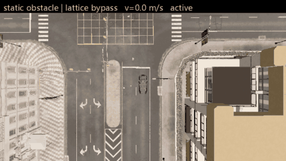 | 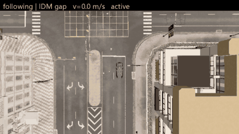 |
| Lattice → ST-DP → QP → MPC，走了 61.0 m，横向 RMSE 0.097 m，没撞，从停着的车旁边绕过去 | 前车进 IDM，最近大约 5.04 m，走了 53.3 m |

| 弯道跟踪 seed 7 | 转角延迟 150 ms seed 19 |
|---|---|
| 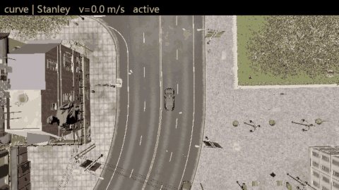 |  |
| Stanley 跟路，走了 37.6 m | 执行器队列延迟 150 ms，走了 44.1 m |

| 指令超时 seed 19 | 状态超时 seed 19 |
|---|---|
| 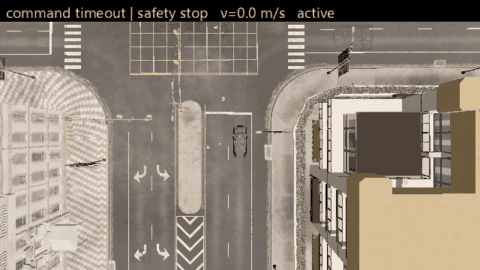 | 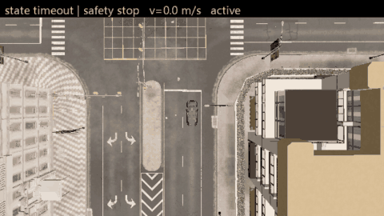 |
| 后半程把指令时间戳弄过期，Safety 把车刹停 | 后半程把状态时间戳弄过期，同样刹停。两张图长得像，差别是谁过期 |

Python / C++ 对照 1000 例，最大差大约 1.42e-14。ROS 到 CARLA 的延迟 P50 / P95 是 0.64 / 0.95 ms。PPO 和 Stackelberg 是解析自行车模型，不是在 CARLA 里上路。

仿真里修过：CARLA 轮坐标曾经被当成局部米制，轨迹会飞；一挡离合器瞬态能把加速度打到 12～15 m/s²。所以仿真过了还是要上车。

## 实车跑完什么样

起点：砖缝左边 15 cm，车头顺缝，尾巴对齐胶条 0，巡航 0.15 m/s，盒子放在缝上大约 1 m。y 往左为正。

<p>
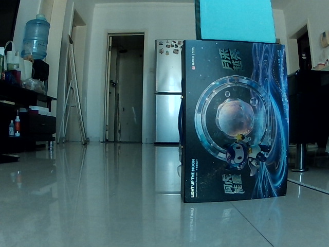
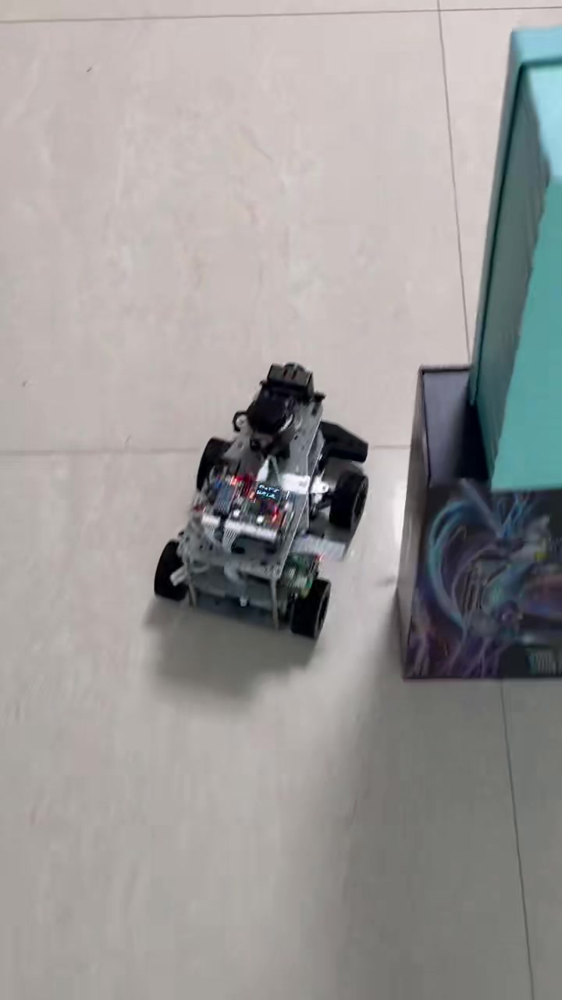
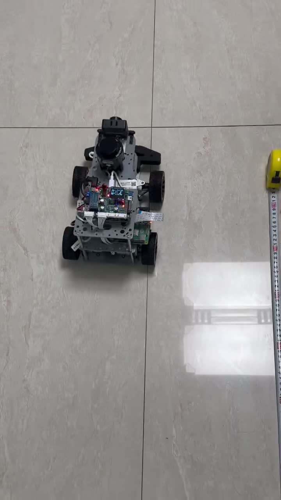
</p>

<p>
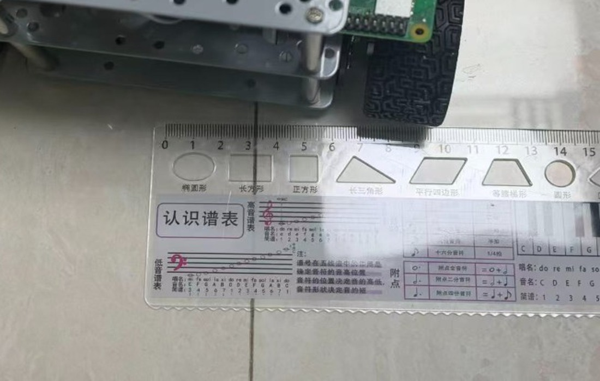
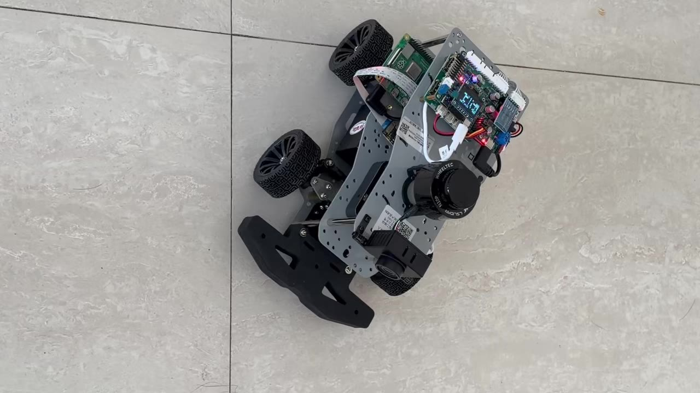
</p>

| 这块 | 实际跑完什么样 |
|---|---|
| PID / Stanley / LQR / 双 MPC | 双 MPC 横向大概偏 1 cm。Stanley 用 k=0.2，LQR 横向权重 18，右轮外沿能贴上砖缝 |
| Lattice | 看到盒子就往左绕，然后再往砖缝收回来 |
| ST-DP + QP | 卷尺上看，差不多停在 2 m |
| 相机 | 有盒子绕开；拿走以后贴缝直行，大概偏左 1 cm |
| ROS2 | `/cmd_vel` 和 `/odom` 对着说话。有一趟绕完：往前 1.97 m，横向 5.8 cm，航向大约 −1.3° |

## 怎么跑

```bash
python -m pip install -e ".[dev,profiling]"
python -m pytest -q
```

CARLA（Windows 开 0.9.15，WSL 里连）：

```bash
python -m pip install -e ".[dev,sim,profiling]"
python -m demos.carla_record_gallery --host WINDOWS_HOST_IP --output artifacts/readme_gallery_v2
```

实车（树莓派，ROS2 Humble）：

```bash
source /opt/ros/humble/setup.bash
python3 onboard/r550_ros2_demo.py
```
