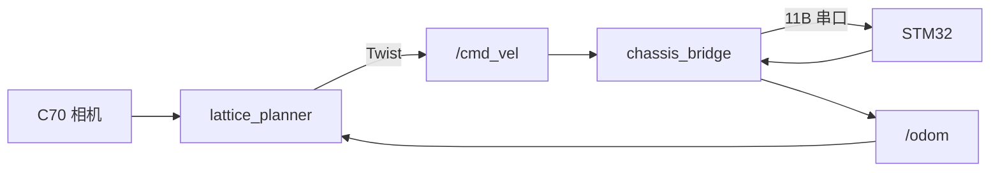
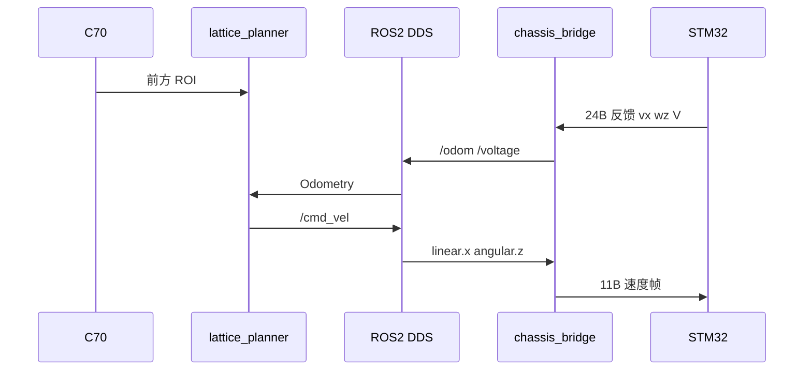

# FalconPlan

[](https://github.com/Leo-7GOAT/FalconPlan/actions/workflows/software.yml)
[](https://github.com/Leo-7GOAT/FalconPlan/actions/workflows/ros2.yml)

自己搭的一套阿克曼规控：横向控制、Frenet Lattice、ST 速度规划、IDM 行为、相机占栅。仿真在本机 **CARLA 0.9.15** 上按场景重跑过；实车是 **WHEELTEC R550**（树莓派 4B + ROS2 Humble），规划只发 `/cmd_vel`，串口写在 `chassis_bridge` 里。

更细的地上记录：[docs/VEHICLE_ONBOARD.md](docs/VEHICLE_ONBOARD.md)。代码入口：`planning/`、`control/`、`behavior/`、`onboard/`。

## 框架

相机 / 里程计进决策，Lattice 出路径，ST-DP 再 QP 出速度，MPC / LQR / Stanley 跟踪，最后变成底盘 `vx, ω`。



车上两个 ROS2 节点跑在同一进程，话题是真的 DDS，不是函数对函数直调。

## 公式

坐标系：后轴中心，$x$ 向前，$y$ 向左，$\psi$ 逆时针为正。R550 轴距 $L=0.144\,\mathrm{m}$，轮距 $0.162\,\mathrm{m}$，轮径 $0.065\,\mathrm{m}$，控制周期 $0.05\,\mathrm{s}$。阿克曼：

$$
\omega=\frac{v}{L}\tan\delta,\qquad |\delta|\le 0.38\,\mathrm{rad},\quad |\omega|\le 0.30\,\mathrm{rad/s}
$$

### Stanley

$$
\delta=\tilde{\psi}+\arctan\left(\frac{k\,e}{v+\varepsilon}\right)
$$

$k$ 我是从 0.8 往下砍的。0.8 和 0.4 在 15 cm 初始偏差时舵角直接顶死 $0.38\,\mathrm{rad}$，两条指令看起来一样，车都会冲过缝。落到 **$k=0.2$，$\varepsilon=0.15$** 才开始能收回来。没有加曲率前馈。

### LQR

状态 $x=[e,\tilde{\psi}]^\top$，离散化以后解 DARE 得到 $K$。库默认 $Q=\mathrm{diag}(1,1)$、$R=10$，这辆车太软，地上会过缝。把横向权重加到 18 之后，起步转角才和那次能贴缝的 Stanley 接近：

$$
Q=\mathrm{diag}(18,1),\qquad R=10
$$

圆弧上曲率前馈只加一次，加在后轴 $\arctan(L/R)$。不要和前轴投影的航向误差再加一遍，否则半径会收到大约 0.5 m。

### 纵向 / 横向 MPC

纵向跟 $s,v$，惩罚 $\Delta v$，箱约束 $0\le v\le v_{\max}$。横向把横向误差和航向丢进 QP，舵角和转角变化率限幅。实车周期 50 ms，预测步数纵向 16、横向 10。双 MPC 贴缝大约 **1 cm**。

### Frenet Lattice

沿弧长采横向目标 $y^\star$ 和收束距离，五次多项式满足端点位置、一阶、二阶为零：

$$
y(s)=y_0+c_3 u^3+c_4 u^4+c_5 u^5,\qquad u=s-s_0
$$

碰撞用圆：障碍半径 + 车体半径 + 余量。绕障目标 $y\in\{0.15,0.28,0.34,0.40\}\,\mathrm{m}$（地面系，砖缝为 0）。

回缝这步踩过坑：收束距离写成 0.90 时，终点已经超出 2 m 停车线，候选全被滤掉，车就不会回缝。后来改成 `RETURN_SETTLES=(0.70, 0.80)`，并禁止绕行中途再把目标扩到 0.40，否则回缝会甩到右边十几厘米。

### ST-DP + 速度 QP

ST 图上障碍占栅，DP 走速度误差和加速度，再 QP 抹平：

$$
\min_v\ \|v-v_{\mathrm{dp}}\|^2+\lambda\|Dv\|^2
$$

0.5 s 滚动重规划。卷尺 2 m 不是轮子账上的 2.00 m：匀速滑行会多走，按减速度提前收零又会把转向一起收小。最后留下的是账上目标大约 1.95～1.98 m，最后 0.50 m 线性降速。

### IDM

$$
s^\star=s_0+\max\left(0,\; vT+\frac{v\Delta v}{2\sqrt{ab}}\right),\qquad
a_{\mathrm{idm}}=a\left(1-(v/v_0)^4-(s^\star/s)^2\right)
$$

实车 $s_0=0.40\,\mathrm{m}$，$T=1.0\,\mathrm{s}$，$a=0.35\,\mathrm{m/s^2}$。MOBIL 激励阈值 0.1。有盒子时 FSM 先等待再左绕，空了就贴缝直行。

### 相机占栅

C70 `/dev/video2`，640×480 MJPEG。前方 ROI 均值低于 95 当有盒子；亮且对比低（block>98、contrast<22，连续 4 帧）当空。空阈值一开始写大了，地板亮度 105 左右永远判不成空，车会在没盒子的时候还绕。

## ROS2 话题

| 话题 | 类型 | 方向 |
|---|---|---|
| `/cmd_vel` | `geometry_msgs/Twist` | planner → bridge |
| `/odom` | `nav_msgs/Odometry` | bridge → planner |
| `/voltage` | `std_msgs/Float32` | bridge → planner |



底盘帧：`0x7B` + vx + vy=0 + wz（大端 int16，mm/s、mrad/s）+ XOR + `0x7D`。正 `wz` 向左。退出先发大约 6 s 零速。这辆车**断线不会自己停**，人要站在电源开关旁边。

## CARLA 0.9.15

下面六张是本机服务器重跑的，俯视相机，标题就是场景名。Town10HD 的“弯道”其实很缓，Stanley 最大转角大约 0.035 rad，不要指望看到发卡弯。jerk 仍然超 6，所以整场是 PARTIAL，不是把仿真包装成全过。

| 静态障碍 seed 7 | 跟车 seed 7 |
|---|---|
|  |  |
| Lattice → ST-DP → QP → MPC，位移 61.0 m，CTE RMSE 0.097 m，零碰撞，从停着的车旁边绕过去 | 前车进 IDM，最小间距 5.04 m，位移 53.3 m |

| 弯道跟踪 seed 7 | 转角延迟 150 ms seed 19 |
|---|---|
|  |  |
| Stanley 跟路，位移 37.6 m。路弯得浅，图上也是浅弯 | 执行器队列 150 ms，位移 44.1 m |

| 指令超时 seed 19 | 状态超时 seed 19 |
|---|---|
|  |  |
| 后半程指令时间戳故意过期，Safety 锁停，$v=0$ | 后半程状态时间戳过期，同样锁停。两张图看起来像，差别在锁存原因 |

其它：Python / C++ 对照 1000 例最大差 $1.42\times 10^{-14}$；ROS→Safety→CARLA 延迟 P50/P95 为 0.64 / 0.95 ms。PPO 和 Stackelberg 是解析自行车模型，不是 CARLA 上路。

仿真里修过的：CARLA 轮坐标曾经被当成局部米制，轨迹会飞；一挡离合器瞬态能把加速度打到 12～15 m/s²。所以仿真过了还是要上车。

## 实车（R550）

起点：砖缝左边 15 cm，车头顺缝，尾对齐胶条 0，巡航 0.15 m/s，盒子放在缝上大约 1 m。+y 向左。

C70 看到的障碍、绕行、停在 2 m、尺子量横向、四分之一圆：

<p>


</p>

<p>


</p>

| 模块 | 地上留下的 |
|---|---|
| Stanley / LQR / 双 MPC / PID | MPC 大约 1 cm；Stanley $k=0.2$、LQR $Q=\mathrm{diag}(18,1)$ 能把右轮外沿贴到缝上 |
| Lattice | 有盒子向左绕，再往回收 |
| ST-DP + QP | 胶条读数大约 2 m |
| 相机占栅 | 有盒子绕；拿走以后贴缝直行，偏左大约 1 cm |
| ROS2 | `/cmd_vel` ↔ `/odom` 绕行跑通。例：$x=1.97\,\mathrm{m}$，$y=0.058\,\mathrm{m}$，航向 $-1.3^\circ$ |

告诉控制器的初始偏差**不是**地上那 15 cm。轮子积分和卷尺对不上，控制器把账收到 0 就不再往缝上凑。Stanley 匀速贴缝用的是告诉它 10 cm；LQR 匀速贴缝用的是 4.8 cm。换减速策略以后，同一个 4.8 cm 又贴不住，这是积分误差，不是权重又坏了。

## 怎么跑

```bash
python -m pip install -e ".[dev,profiling]"
python -m pytest -q
```

CARLA（Windows 开 0.9.15，WSL 里连）：

```bash
python -m pip install -e ".[dev,sim,profiling]"
python -m demos.carla_record_gallery --host WINDOWS_HOST_IP --output artifacts/readme_gallery_v2
```

实车（树莓派，ROS2 Humble）：

```bash
source /opt/ros/humble/setup.bash
python3 onboard/r550_ros2_demo.py
```

## 没做 / 别当成证书的

断线急停、厂家官方驱动、Hybrid A\*、第二辆车，都没有。绕行停姿还有厘米级残差。PPO 加质量 / 组合扰动没过门。仿真 jerk 超标，所以动图上写的是 PARTIAL。
