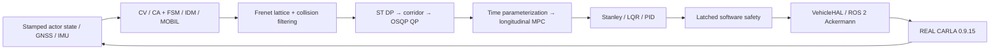
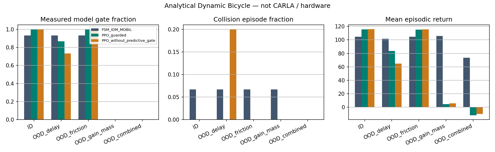

# FalconPlan

[](https://github.com/Leo-7GOAT/FalconPlan/actions/workflows/software.yml)
[](https://github.com/Leo-7GOAT/FalconPlan/actions/workflows/ros2.yml)

Vehicle planning and control engineering that connects classical algorithms, a numerically verified C++17 core, ROS 2 safety transport and **real CARLA 0.9.15 physics**. Current delivery: a verified software stage; physical deployment and Raspberry Pi HIL are **PENDING_HARDWARE**.

**Evidence at this stage:** 579 native-enabled Python tests, 9 Release + 9 ASan/UBSan C++ tests, actual ROS2/CARLA stop-and-replay verification, a 12-run sensor-feedback study, two independently trained final PPO policies and an enumerated Stackelberg baseline. Passing components have bounded scopes; physical jerk, robust policy behavior and full-loop timing still need work.

[Baseline audit](docs/BASELINE_AUDIT.md) · [Measured benchmarks](docs/SIMULATION_BENCHMARK.md) · [Hardware preparation](docs/HARDWARE_READINESS.md) · [Acceptance matrix](docs/FINAL_DELIVERY_REPORT.md) · [Interview notes](docs/INTERVIEW_TECHNICAL_GUIDE.md)

[Sensor-feedback evidence](artifacts/carla_estimation/REPORT.md) · [PPO experiment](docs/LEARNING_EXPERIMENT_REPORT.md) · [Stackelberg experiment](docs/STACKELBERG_EXPERIMENT.md)



The complete classical planning chain uses explicitly labelled actor truth. The separate sensor-feedback study initializes from real GNSS/IMU callbacks and drives Stanley/PID/Safety/actuator feedback without Ego truth reads; it does not automatically validate sensor integration into every planner or the ROS transport.


[Real simulation GIF](artifacts/carla/static_obstacle_seed7/simulation.gif) · [Analytical dynamics comparison](artifacts/dynamics/comparison.png)


## Implementation and measured evidence

| Layer | Implementation | Verified boundary |
|---|---|---|
| Prediction / behavior | CV/CA, TTC/THW, FSM, IDM, MOBIL | Actor-level truth; no perception claim |
| Planning | Frenet lattice, quartic/quintic, segment collision, dynamic ST projection, DP, corridor, OSQP QP | Unit tests and online real-simulator orchestration |
| Control | PID anti-windup, Stanley, LQR, receding longitudinal MPC | Solver limits and physical plant limits evaluated separately |
| Dynamics | Kinematic RK4, friction-limited dynamic bicycle, delayed first-order actuators | Analytical model experiments separately labeled |
| C++17 | State/command/path structures, PID, Stanley, RK4, nearest-path search, constant jerk, candidate cost / continuous collision / selection, checked C ABI | 9 GoogleTests Release and ASan/UBSan; 1,000 core parity samples, 2,000 planning candidates and 10,000 controller calls |
| Safety | Timestamp expiry, geofence, speed/steering/rate limits, manual, latched software E-stop | Software / simulator stop only |
| Real I/O | CARLA spawn/destroy, sync tick, actors, control, collision/RGB/GNSS/IMU | Real 0.9.15 engine; separate sensor-only feedback path with GT access traps and original freshness gates |
| Experimental learning / game | Actual PPO-Clip, FSM/IDM/MOBIL comparison, finite-action Stackelberg best responses and robust veto | Analytical dynamic/model experiments; weights, seeds, curves and negative OOD results retained; policy CARLA integration pending |
| ROS 2 | Humble Ackermann/Odometry, TF, safety services, CARLA bridge, rosbag | Real ROS transport; hardware pending |
| Engineering | Packaging, CPU/RSS profiling, JSONL replay/fault injection, release staging/rollback, CI | CI definitions are not passing badges |

| Checkpoint | Measured result |
|---|---|
| Python inherited baseline | 483 passed |
| Latest software regression | WSL, native planning and Torch: **579 passed in 10.25 s**; earlier Windows checkpoint: 524 passed, 11 native/Linux skips |
| Python/C++ parity | Seed 42, 1,000 cases, max absolute difference **1.42e-14** |
| DP → QP → MPC analytical demo | Position RMSE **0.0521 m**, speed RMSE **0.0297 m/s**, dense ST check passed |
| CARLA initial PID suite | 7 scenarios × seeds 7/19, 12 s/run, zero collisions after axle-coordinate correction |
| Online CARLA full-chain checkpoint | Following/static displacement **53.97/61.61 m**, CTE RMSE **0.000127/0.0802 m**, zero collisions; physical acceleration acceptance **PARTIAL** |
| Updated manual-gear sensor runs | 4 × 20 s: motion/acceleration passed; actual max acceleration **2.89–2.92 m/s²**, GNSS/IMU position RMSE **0.073–0.104 m**; jerk **78–87 m/s³ remains PARTIAL** |
| C++ in-process full-chain recovery | Following/static seed 7, 20 s each: motion and +3/−6 m/s² acceleration envelope pass, zero collisions; jerk **PARTIAL**, planner P95 **327/87 ms** |
| Final seven-scene raw regression | 14 × 12 s: motion and ideal-sensor diagnostics pass, zero collisions; **14/14 overall PARTIAL**, with measured jerk and some acceleration limits exceeded |
| Real ROS → Safety → CARLA | 802 samples; latency P50/P95/P99 **0.641/0.950/1.350 ms**, timer jitter σ **0.348 ms** |
| Sensor-only CARLA control | 6 profiles × 2 seeds: **10/12 feedback PASS**, 2 long-dropout accuracy failures; **0/12 full physical-envelope PASS** |
| Analytical actuator delay | CTE RMSE **0.5876 → 0.3301 m** after gain reduction; 20 m/s low-friction OOD case **FAIL** |

The initial PID acceleration log was clipped and is excluded from physical acceleration claims. Updated runs record raw measurements and command intent separately. Normal PID scenes exceed the +3 m/s² target; emergency stops exceed the nominal deceleration/jerk envelope. Online Python planning runs at 2 Hz; observed P95 can approach 0.5 s. This is synchronous simulator evidence, not a 20 Hz real-time full-stack certification. Latest versioned JSON reports retain tuning failures. The original 16 milestone groups contain **12 accepted / 4 partial (75% by milestone count)**; numerical PPO/game experiment acceptance does not authorize learned road control.

## Learning and interaction: actual results, including failures

PPO chooses acceleration and lane; a classical controller, predictive guard and the same nominal actuator/Safety contracts execute both learned and FSM/IDM/MOBIL policies. The final policies use training seeds 7/19, **262,144 actual transitions each**, with five independent evaluation seeds and three scenarios per domain. Earlier versions remain in Git; five substantive training runs total 1,179,648 transitions. This is the repository's analytical dynamic bicycle model, **not CARLA**.

| Final paired evaluation | PPO seed 7 | PPO seed 19 | Interpretation |
|---|---:|---:|---|
| ID, 15 episodes per policy | 15/15 model gates | 15/15 model gates | Zero collisions/offroad; speed RMSE 3.77/3.70 m/s is worse than the classical baseline's 2.64 m/s |
| 250 ms actuator delay | 13/15 | 15/15 | Seed 7 has two offroad failures |
| Friction 0.4 | 15/15 | 15/15 | Bounded tested model envelope |
| Gain +40% / increased mass | 0/15 | 0/15 | Measured jerk exceeds 6 m/s³ |
| Combined perturbations | 0/15 | 0/15 | Jerk and offroad failures; overall policy robustness remains PARTIAL |

The shared plant-aware envelope and internal 11.999 m/s target changed between experiment versions; gains across versions cannot be attributed solely to PPO. Within each paired evaluation, every policy uses the same version. [Weights, reward curves, source hashes and exact results](docs/LEARNING_EXPERIMENT_REPORT.md).



The Stackelberg baseline explicitly enumerates leader strategies and follower best responses. **540 numerical cases** compare CV, Stackelberg and a bounded robust veto across three seeds and three domains. In noncooperative OOD, the unguarded game predicts **37/60 collisions**; the veto predicts zero within its finite action set but completes only **2/60** merges. This exposes the cooperation/progress tradeoff; it is a planning-model experiment, with CARLA negotiation still pending. [Payoff matrices, trajectories and implementation](docs/STACKELBERG_EXPERIMENT.md).

## Setup and reproduction

Python 3.10+; Windows Python 3.11 for algorithms, Ubuntu 22.04 / WSL Python 3.10 for matching CARLA API and ROS Humble.

```bash
python -m pip install -e ".[dev,profiling]"
python -m pytest -q
MPLBACKEND=Agg python -m demos.w07_dp_qp_speed_demo
MPLBACKEND=Agg python -m demos.w07_longitudinal_mpc_demo
python -m demos.dynamics_benchmark
python -m demos.stackelberg_merge --output artifacts/game/my_run --seeds 7 17 27
```

The Agg prefix is Bash syntax. In PowerShell set `$env:MPLBACKEND='Agg'` first; omit it for interactive plots.

```bash
# WSL; CARLA 0.9.15 server already running on Windows
python -m pip install -e ".[dev,sim,profiling]"
python -m demos.carla_regression --host WINDOWS_HOST_IP --steps 240 --seeds 7,19
python -m demos.carla_regression --host WINDOWS_HOST_IP --steps 400 --seeds 7,19 \
  --scenarios following,static_obstacle --full-stack --mpc --output artifacts/new_full_stack
python -m demos.carla_actuator_identification --host WINDOWS_HOST_IP --manual-gear
python -m demos.carla_estimation_regression --host WINDOWS_HOST_IP --steps 400 \
  --seeds 7,19 --output artifacts/my_sensor_feedback
```

Read WSL's default gateway via `ip route` for the host-specific Windows IP. Only one process may own synchronous ticks. Regression returns nonzero for failed/partial acceptance and keeps its logs.

```bash
# Ubuntu: CMake, GCC and libgtest-dev required
cmake -S cpp -B build/cpp -DCMAKE_BUILD_TYPE=Release
cmake --build build/cpp -j4
ctest --test-dir build/cpp --output-on-failure
python -m tools.cpp_parity --probe build/cpp/core_probe
python -m tools.cpp_binding_benchmark --library build/cpp/libfalcon_c.so
cmake -S cpp -B build/asan -DFALCON_SANITIZE=ON -DCMAKE_BUILD_TYPE=Debug
cmake --build build/asan -j4
ctest --test-dir build/asan --output-on-failure
```

[ROS execution scripts](ros2/) · [Commissioning, recording, calibration, replay and rollback](tools/hardware/README.md)

Reproduce actual learning separately:

```bash
python -m pip install -e ".[rl,dev,profiling]"
python -m demos.learning.train_ppo --seed 7 --steps 262144 --output artifacts/my_ppo
python -m demos.learning.evaluate_ppo --weights artifacts/my_ppo/policy.pt \
  --output artifacts/my_ppo_evaluation
```

The evaluation keeps every failed performance gate and returns nonzero for an overall PARTIAL result. CPU CI separately verifies a 512-step training/inference process; its pass does not convert the full OOD experiment to a policy-safety pass.

The CARLA driver optionally executes the C++ Stanley kernel in process with `--cpp-lib build/cpp/libfalcon_c.so`. Python remains responsible for the lattice/DP/QP/MPC executive. With `FALCON_PLANNING_CPP_LIBRARY`, C++ also executes candidate cost, continuous collision and selection; polynomial generation, feasibility, ST-DP/QP and MPC remain Python. The scalar FFI benchmark is recorded honestly, including cases where call overhead makes C++ slower than Python.

## Simulation failures and the fixes that were verified

| Observed problem | Diagnosis | Implemented correction and evidence |
|---|---|---|
| Large trajectory error despite a plausible Stanley controller | CARLA wheel coordinates were world centimeters; the HAL treated them as local metric axle coordinates | Project wheel positions into the actor frame, convert units/handedness, and use the rear-axle state contract. Subsequent real-simulator regressions moved along the intended route with zero collisions in the bounded suite. |
| Requested acceleration looked bounded while the car accelerated at 12–15 m/s² | The automatic first-gear clutch and throttle mapping introduced a physical transient; the initial clipped log concealed its magnitude | Retain raw finite-difference acceleration/jerk, test real throttle steps, select manual first gear and use acceleration feedback. Nominal full-stack acceleration now meets +3/−6 m/s² in accepted runs; measured jerk still fails and stays PARTIAL. |
| GNSS/IMU EKF diverged by kilometers at spawn | An impossible first-spawn IMU derivative corrupted prediction | Reject and count implausible packets; the four diagnostic reruns achieve 0.073–0.104 m position RMSE. Sensor diagnostics and sensor-driven control are recorded as separate experiments. |
| A static-obstacle full-stack run failed near standstill | Tiny contact rollback produced a negative initialization speed unsupported by the forward speed planner | Use zero only for the explicitly bounded standstill planner initialization; reject genuine reverse motion. The retained rerun passes motion and acceleration, while its jerk remains unaccepted. |
| A collision-free synchronous run missed the intended control period | Python planning/solver work sometimes exceeded the 50 ms budget | Move actual candidate evaluation/collision/selection into C++, measure its matched-kernel benefit, and retain full-loop deadline gaps. Faster kernels do not establish a real-time stack. |

Failed logs remain versioned. A solver returning a bounded command is insufficient evidence that the physical plant obeyed it.

## Why a good simulation may fail on a real vehicle

**Physical deployment has not been performed.** The following are engineering hypotheses and a proposed validation plan, grounded in the measured simulator failures above.

| Likely deployment gap | Why it matters | Proposed measurement and mitigation |
|---|---|---|
| Steering geometry, backlash, deadzone, saturation and lag | A steering command may produce a different wheel angle or arrive after the controller's assumed time | Obtain the exact chassis protocol and geometry; log bounded supported-wheel steering steps, fit delay/rate/deadzone, and validate the inverse actuator map. Include the measured queue/lag in prediction and MPC; derate speed until tracking is verified. |
| Tire friction, load transfer, payload and braking authority | The kinematic model can track perfectly while a real tire slips or braking is weaker than assumed | Identify response at low speed; compare dynamic-model predictions against held-out logs. Test mass/friction/grade envelopes, measure stopping distance, then choose a validated operating envelope and conservative braking margins. Existing low-friction/OOD failures are reasons to restrict operation. |
| GNSS noise/outage, IMU bias/extrinsics and wheel-odometry errors | Real localization can drift or jump; controller performance depends on measurement quality and age | Calibrate axes, bias and sensor mounting; synchronize clocks, use sensor timestamps and reject inconsistent innovations. Measure estimation error against an independent reference; gate commands on freshness and uncertainty, with a verified stop on prolonged loss. |
| CAN/serial jitter, dropped commands and small-computer overload | Synchronous CARLA waits for computation; a moving vehicle continues while software is late | Measure Pi control-period jitter and end-to-end command acknowledgement under CPU/network load. Use bounded queues, command expiry and a local driver watchdog; optimize the measured bottleneck and test deadline-failure behavior on the target. |
| Incorrect frame signs, units, clock domains or vendor semantics | A numerically correct algorithm can steer in the wrong direction or accept an old command | Start with read-only telemetry and explicit SI/frame tests; verify steering sign, timestamp ordering, neutral/brake semantics and disconnect behavior before closed-loop motion. Unknown R550 fields remain null until supported by vendor evidence. |
| Power loss, process crash and manual takeover | A final software brake message may never reach a failed driver or disconnected actuator | Validate an independent physical E-stop/power-isolation mechanism and driver-local command timeout. Test process kill/cable loss and manual takeover in a controlled setup; software stop evidence alone cannot establish this behavior. |

The deployment sequence is **read-only logs → supported-wheel actuator identification → replay and fault injection → controlled low-speed tracking → target timing and stopping tests → wider validated envelope**. Keep command, measured state, receipt time and intervention reason in the same trace. Change one assumption at a time and compare a before/after run against the same acceptance gates.

An interview answer grounded in this project is: *simulation performance depends on assumptions about state quality, actuator response and timing. We already found that correct solver bounds did not guarantee CARLA acceleration or jerk. On hardware I would first measure the sensor/actuator/time contracts, identify the mismatch from logs, and validate each correction at low speed before expanding the envelope.* This describes the proposed deployment method, not claimed real-vehicle experience.

## Current limitations

CARLA wheel positions are world centimeters: treating them as local axle coordinates caused tens of meters of tracking error. The adapter now projects them into the actor frame and explicitly converts handedness. Real step sweeps identified automatic first-gear clutch acceleration spikes of 12–15 m/s²; manual first gear reduced the same throttle sweep to approximately 2–3 m/s². Raw before/after logs are retained. A native Ackermann-servo experiment also failed with a collision.

The full classical planning stack and obstacle states use truth localization; the separate GNSS/IMU control study passes ten feedback cases, while long-dropout accuracy and every complete physical-envelope case remain unaccepted. Circular geometry, lane-selection assumptions, intersections, traffic compliance, perception and a full ODD safety case remain limited. PPO/Stackelberg have actual numerical experiment evidence; road integration, opponent-model robustness and failed OOD envelopes remain open. R550 steering geometry, protocol and calibration remain unknown. **Hardware-Ready / Pending Physical Validation** describes the software adapter/tooling interface, not a physically validated vehicle.

Native planning reproduction after the C++ build:

```bash
FALCON_PLANNING_CPP_LIBRARY=build/cpp/libfalcon_c.so python -m pytest -q
python -m tools.cpp_planning_benchmark --library build/cpp/libfalcon_c.so
FALCON_PLANNING_CPP_LIBRARY=build/cpp/libfalcon_c.so python -m demos.carla_regression \
  --host WINDOWS_HOST_IP --steps 400 --seeds 7 --scenarios static_obstacle \
  --full-stack --mpc --cpp-lib build/cpp/libfalcon_c.so --output artifacts/new_cpp_planning
```

The C++ cost/collision/selection kernel is actually used by the live planner. Its two-thousand-candidate parity study has maximum cost error 4.55e-13 with no collision/selection mismatch. Full native-enabled WSL regression: **535 passed**; the recorded CARLA integration still returns PARTIAL because physical jerk exceeds its unchanged acceptance limit. Original week-level acceptance is **9/16 (56.25%)**, a count of fully accepted milestone groups, not engineering effort.
