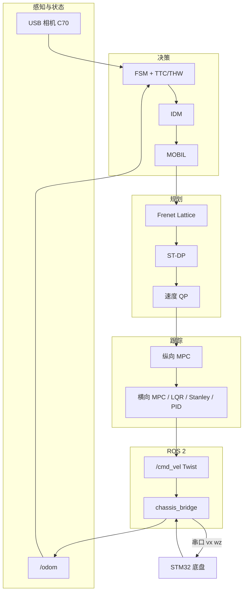
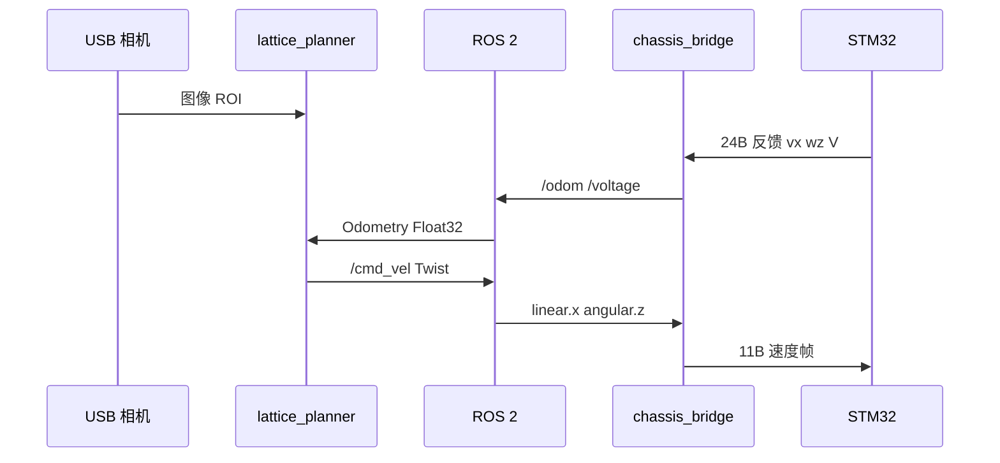
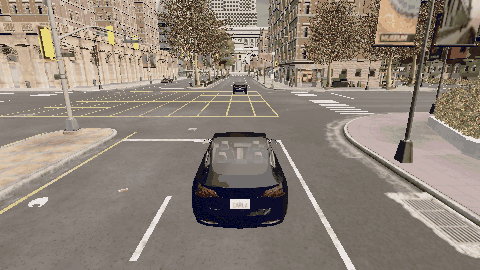
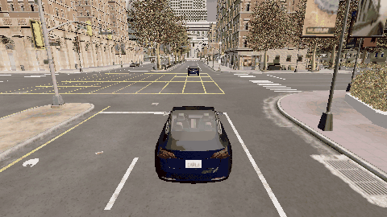
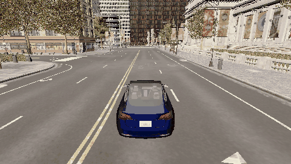
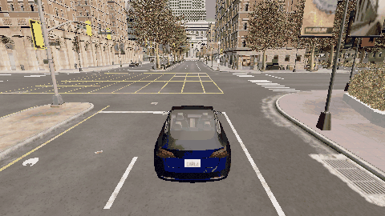
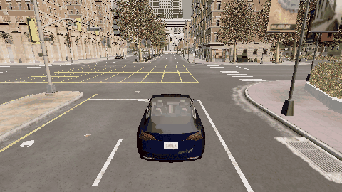

# FalconPlan

[](https://github.com/Leo-7GOAT/FalconPlan/actions/workflows/software.yml)
[](https://github.com/Leo-7GOAT/FalconPlan/actions/workflows/ros2.yml)

Planning and control stack: PID / Stanley / LQR / MPC, Frenet lattice, ST-DP + QP speed, IDM/MOBIL, camera occupancy, ROS 2 Humble on a WHEELTEC R550, and CARLA 0.9.15. 582 tests. Details below in Chinese.

面向规控算法的车辆规划与控制栈：经典控制 / Lattice / ST 速度规划 / 行为决策 / 学习，经 **ROS 2 Humble** 接到 **WHEELTEC R550 阿克曼小车** 与 **CARLA 0.9.15**。

- 软件：Python 算法 + C++17 核（PID / Stanley / 碰撞代价），582 项测试。
- 仿真：CARLA 全链路 Lattice → ST-DP → QP → MPC，零碰撞验收场景。
- 实车：R550 + 树莓派 4B，算法节点发 `/cmd_vel`，`chassis_bridge` 写串口并回 `/odom`。

更细的实车记录见 [docs/VEHICLE_ONBOARD.md](docs/VEHICLE_ONBOARD.md)。仿真数字见 [docs/SIMULATION_BENCHMARK.md](docs/SIMULATION_BENCHMARK.md)。

## 框架



仓库分层：`behavior/` 决策，`planning/` 路径与速度，`control/` 跟踪，`onboard/` 实车 ROS2 节点，`ros2/falcon_ros/` CARLA / mock 桥，`cpp/` 核，`demos/` 仿真。

## 理论与公式

坐标系：车后轴中心，\(x\) 向前，\(y\) 向左，\(\psi\) 逆时针为正。R550 轴距 \(L=0.144\,\mathrm{m}\)，轮距 \(0.162\,\mathrm{m}\)，轮径 \(0.065\,\mathrm{m}\)。控制周期 \(0.05\,\mathrm{s}\)。阿克曼：

\[
\omega = \frac{v}{L}\tan\delta,\qquad |\delta|\le 0.38\,\mathrm{rad},\quad |\omega|\le 0.30\,\mathrm{rad/s}
\]

### Stanley

\[
\delta = \tilde{\psi} + \arctan\frac{k\,e}{v+\varepsilon}
\]

实车直线取 \(k=0.2\)，\(\varepsilon=0.15\)。

### LQR

状态 \(x=[e,\tilde{\psi}]^\top\)，离散化后 DARE 求 \(K\)。实车权重 \(Q=\mathrm{diag}(18,1)\)，\(R=10\)。

### 纵向 / 横向 MPC

纵向：跟踪 \(s,v\)，惩罚 \(\Delta v\)，箱约束 \(0\le v\le v_{\max}\)。横向：误差与航向进 QP，舵角与转角变化率限幅。实车周期 50 ms，预测步数纵向 16、横向 10。

### Frenet Lattice

纵向弧长上采样横向目标 \(y^\star\) 与收束距离，五次多项式满足端点位置、一阶、二阶为零：

\[
y(s)=y_0+c_3 u^3+c_4 u^4+c_5 u^5,\quad u=s-s_0
\]

碰撞圆检验：障碍半径 + 车体半径 + 余量。实车绕障目标 \(y\in\{0.15,0.28,0.34,0.40\}\,\mathrm{m}\)（地面系，缝为 0）。

### ST-DP + 速度 QP

ST 图上障碍占栅，DP 代价含速度误差与加速度，再 QP 光滑：

\[
\min_v\ \|v-v_{\mathrm{dp}}\|^2 + \lambda\|Dv\|^2
\]

0.5 s 滚动重规划。

### IDM

\[
s^\star = s_0 + \max\Bigl(0,\; vT + \frac{v\Delta v}{2\sqrt{a b}}\Bigr),\quad
a_{\mathrm{idm}}=a\Bigl(1-(v/v_0)^4 - (s^\star/s)^2\Bigr)
\]

实车 \(s_0=0.40\,\mathrm{m}\)，\(T=1.0\,\mathrm{s}\)，\(a=0.35\,\mathrm{m/s^2}\)。MOBIL 激励阈值 0.1。

### 相机占栅

C70 `/dev/video2`，640×480 MJPEG。前方 ROI 均值低于 95 视为有盒子；亮且对比低视为空。有盒子：等待后 Lattice 左绕。拿走盒子：贴缝直行。

## ROS 2 话题

实车两个节点，DDS 话题，串口只在桥里：



| 话题 | 类型 | 方向 |
|---|---|---|
| `/cmd_vel` | `geometry_msgs/Twist` | planner → bridge |
| `/odom` | `nav_msgs/Odometry` | bridge → planner |
| `/voltage` | `std_msgs/Float32` | bridge → planner |

底盘帧：`0x7B` + vx, vy=0, wz 大端 int16（mm/s、mrad/s）+ XOR + `0x7D`。正 `wz` 向左。退出 6 s 零速。断线底盘不会自己停，人须在开关旁。

仿真侧另有 CARLA 桥：`/falcon/safe_command`（Ackermann）与 Safety 锁存，见 `ros2/falcon_ros/`。

## 仿真结果（CARLA 0.9.15）

完整 RGB 回放（约 5 fps）。指标来自实跑，不是示意动画。

| 静态障碍 seed 7 | 跟车 seed 7 |
|---|---|
|  |  |
| Lattice→ST-DP→QP→MPC，位移 61.84 m，CTE RMSE 0.096 m，零碰撞 | 前车状态进规划，位移 53.04 m，零碰撞 |

| 弯道跟踪 seed 7 | 150 ms 转角延迟 seed 19 |
|---|---|
|  |  |
| C++ Stanley / PID | 注入转角队列，位移 44.16 m |

| 命令超时 seed 19 | 状态超时 seed 19 |
|---|---|
|  |  |
| 过期指令软件刹停到 0 | 过期状态软件刹停到 0 |

其它测量：Python/C++ 1 000 例最大差 \(1.42\times10^{-14}\)；DP→QP→MPC 解析 demo 位置 RMSE 0.052 m；ROS→Safety→CARLA 802 样本延迟 P50/P95 **0.64 / 0.95 ms**。PPO 与 Stackelberg 是解析自行车模型实验，不是 CARLA 上路，见 [学习报告](docs/LEARNING_EXPERIMENT_REPORT.md)、[博弈报告](docs/STACKELBERG_EXPERIMENT.md)。

仿真里修过的问题：CARLA 轮坐标曾被当成局部米制导致轨迹飞掉；一挡离合器把加速度打到 12–15 m/s²。这些说明仿真过不等于实车过，所以才上 R550。

## 实车结果（WHEELTEC R550）

树莓派 4B 8GB，Ubuntu 22.04，ROS2 Humble，C30D STM32。起点：缝左 15 cm，尾对齐 0 m，巡航 0.15 m/s，目标约 2 m。

| 模块 | 算法 | 地上（收下） |
|---|---|---|
| 横向 | PID / LQR / 双 MPC / Stanley | MPC 约 1 cm；Stanley / LQR 贴缝见实车报告 |
| 路径 | Frenet Lattice | 已知盒 / 相机盒向左绕并回缝 |
| 速度 | ST-DP + QP，0.5 s 重规划 | 胶条约 2 m |
| 学习 | 直线 RL、带盒 RL | 直线收下；带盒略偏收下 |
| 行为 | IDM + FSM | 有盒等待再绕；空则直行 |
| 相机 | C70 暗块占栅 | 有盒绕行；拿走后贴缝，偏左 1 cm、航向回正 |
| ROS2 | `/cmd_vel` ↔ `/odom` | 相机 + Lattice + MPC 绕行实车跑通 |

ROS2 绕行例：\(x=1.97\,\mathrm{m}\)，\(y=0.058\,\mathrm{m}\)，航向 \(-1.3^\circ\)。拿走盒子直行：偏左约 1 cm，航向约 \(0^\circ\)。

几何与标定、Stanley/LQR 贴缝过程见 [docs/VEHICLE_ONBOARD.md](docs/VEHICLE_ONBOARD.md)。

本房未做：Hybrid A\*、第二辆车、厂家官方驱动替换现有桥。

## 运行

```bash
python -m pip install -e ".[dev,profiling]"
python -m pytest -q
```

CARLA（Windows 上已开 0.9.15 服务，WSL 里跑）：

```bash
python -m pip install -e ".[dev,sim,profiling]"
python -m demos.carla_regression --host WINDOWS_HOST_IP --steps 400 --seeds 7,19 \
  --scenarios following,static_obstacle --full-stack --mpc
```

实车（树莓派，ROS2 Humble）：

```bash
source /opt/ros/humble/setup.bash
python3 onboard/r550_ros2_demo.py
```

## 目录

```
behavior/     FSM IDM MOBIL 预测
planning/     Lattice ST-DP QP 纵向 MPC
control/      PID Stanley LQR 执行器
onboard/      R550 ROS2 实车节点
ros2/         Humble 包、CARLA/mock 桥
cpp/          C++17 核
demos/        CARLA / 解析 demo
docs/         基准、学习、实车
```

## 限制

断线底盘不会自己停。软件零速不是物理急停证书。绕行停姿仍有厘米级横向与航向残差。PPO OOD（增质量 / 组合扰动）未过门。仿真 jerk 部分场景仍 PARTIAL。
