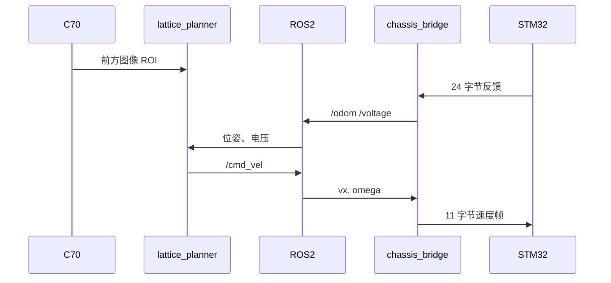

# FalconPlan

[](https://github.com/Leo-7GOAT/FalconPlan/actions/workflows/software.yml)
[](https://github.com/Leo-7GOAT/FalconPlan/actions/workflows/ros2.yml)

自己搭的一套阿克曼规控：横向控制、Frenet Lattice、ST 速度规划、IDM 行为、相机占栅。仿真在本机 CARLA 0.9.15 上按场景重跑过；实车是 WHEELTEC R550，树莓派 4B 跑 ROS2 Humble。规划节点只发 `/cmd_vel`，真正写串口的是 `chassis_bridge`。

更细的实验记录在 [docs/VEHICLE_ONBOARD.md](docs/VEHICLE_ONBOARD.md)。代码在 `planning/`、`control/`、`behavior/`、`onboard/`。

## 车上怎么连的

整车、树莓派、以及树莓派和底盘板的接法：

<p>


</p>

从上往下看：前头是 C70 相机和 N10 雷达，中间是 C30D 控制板（STM32），左边那块绿板是树莓派 4B，CSI 排线接到板载 Camera 口，白线 USB 把树莓派和底盘板连在一起。

| 线 | 接到哪 | 程序里用不用 |
|---|---|---|
| C30D 的 5Vout → 树莓派 | 给派供电 | 用。墙插和 5Vout 不能同时接 |
| 树莓派 USB → 沁恒串口 → STM32 | 底盘速度指令 / 反馈 | 用。`/dev/serial/by-id/usb-WCH.CN_USB_Single_Serial_0002-if00`，115200 8N1 |
| 树莓派 USB → C70 | 前视 640×480 MJPEG | 用。`/dev/video2`，判断前方有没有盒子 |
| 树莓派 CSI → Camera V2 | 排线相机 | 内核认得到，这套 demo 没用它认缝 |
| 另一路沁恒串口 → N10 雷达 | 距离能读 | 这套 demo 没用雷达 |

底盘只吃速度帧，11 个字节：`0x7B`，然后 vx、vy=0、wz 三个大端 int16（单位 mm/s 和 mrad/s），异或校验，`0x7D` 结尾。正的 wz 是向左，这个方向拿录像对过。反馈大约 20 Hz、24 字节。位姿只用后轮编码的 vx、wz 往前积分，陀螺零偏太大，没用。

规划器不直接碰串口。退出时桥节点先发大约 6 秒零速。这车 USB 拔了不会自己停，人要站在电源开关旁边。电压低于 10.8 V 就该充，充电的时候别开车。

## 程序怎么转一圈

车上两个 ROS2 节点塞在同一个进程里，但中间走的是真话题，不是函数对函数硬调。

1. `chassis_bridge` 独占串口。读到底盘反馈，积成位姿，发 `/odom` 和 `/voltage`。
2. `lattice_planner` 订 `/odom`。同时从 `/dev/video2` 抠前方一块 ROI：够暗就当有盒子，够亮且对比低就当空。
3. 有盒子：状态机先等一下，再走 Lattice 左绕。盒子拿走了：贴着砖缝直行。
4. Lattice 给出一条横向路径，ST 图上做 DP，再用 QP 把速度抹顺，纵向 MPC 跟速度，横向 MPC 跟路径。
5. 算完只发 `/cmd_vel`（`linear.x` 是 vx，`angular.z` 是 ω）。桥节点把它翻译成上面那 11 字节，写给 STM32。
6. 周期 50 ms。限幅：速度 0.15 m/s，舵角 0.38 rad，角速度 0.30 rad/s。



| 话题 | 类型 | 谁发给谁 |
|---|---|---|
| `/cmd_vel` | `geometry_msgs/Twist` | 规划 → 桥 |
| `/odom` | `nav_msgs/Odometry` | 桥 → 规划 |
| `/voltage` | `std_msgs/Float32` | 桥 → 规划 |

仿真那边另外有一套 CARLA 桥（`/falcon/safe_command`），和实车这套不是同一条线。

## 公式

坐标系：后轴中心，x 向前，y 向左，ψ 逆时针为正。轴距 L = 0.144 m，轮距 0.162 m，轮径 0.065 m。底盘真正吃的是车体速度 vx 和角速度 ω，前轮转角 δ 用阿克曼换过去：

$$
\omega=\frac{v}{L}\tan\delta
$$

舵角不超过 0.38 rad，角速度不超过 0.30 rad/s。下面每个控制器最后都变成这一对 (vx, ω)。

### PID

直线贴缝时，横向误差 e 进 PID，再加一点航向阻尼，输出 ω：

$$
u=k_{p}e+k_{i}\int e dt+k_{d}\dot{e}
$$

实车横向大概用 kp=1.6、kd=0.2，积分基本不开，免得在积分误差里把缝冲过去。速度另外一路 PID 去跟 0.15 m/s。

### Stanley

前轴投影到路径上，横向误差 e，航向误差 ψ̃。一项把鼻子拧正，一项按横向偏差打方向，速度快了同一偏差少打一点：

$$
\delta=\tilde{\psi}+\arctan\left(\frac{k e}{v+\varepsilon}\right)
$$

k 越大，15 cm 偏差时舵角越容易顶满。实车直线用 k=0.2，ε=0.15。没有曲率前馈。

### LQR

把车看成横向误差和航向误差两个状态，离散化成 x_{k+1}=A x_k + B δ_k，代价是

$$
J=\sum_{k}\left(x_{k}^{\top}Q x_{k}+u_{k}^{\top}R u_{k}\right)
$$

解离散代数 Riccati 方程得到 P，再得到增益 K，u = −K x。实车

$$
Q_{11}=18,\quad Q_{22}=1,\quad R=10
$$

横向权重大，是为了让起步转角接近那次能贴缝的 Stanley。圆弧上曲率前馈只加一次，加在后轴 atan(L/R)。

### 纵向 MPC

速度规划给出一条 s、v 参考。纵向 MPC 在未来 N=16 步里选一串速度，既要跟上参考，又不能一拍加太猛：

$$
\min_{v}\sum_{k=0}^{N-1}\left[Q_{s}(s_{k}-s_{k}^{\ast})^{2}+Q_{v}(v_{k}-v_{k}^{\ast})^{2}+R_{dv}(v_{k}-v_{k-1})^{2}\right]
$$

约束：0 ≤ v ≤ 0.15 m/s，相邻两拍 |Δv| ≤ 0.05 m/s。实车 Q_s=8，Q_v=30，R_dv=2.5。速度权重比位置大，是因为这车轮子账和卷尺对不上，跟速度比跟“账上的 2.00 m”老实。最后 0.50 m 参考速度线性降到 0，MPC 去追这条斜线。

### 横向 MPC

状态还是 [e, ψ̃]，预测 N=10 步。模型按当前车速线性化：横向误差下一拍会按航向往外漂，航向下一拍由舵角改。代价：

$$
\min_{\delta}\sum_{k}x_{k}^{\top}Q_{lat}x_{k}+R_{\delta}\delta_{k}^{2}+R_{d\delta}(\delta_{k}-\delta_{k-1})^{2}
$$

实车 Q_lat 横向 40、航向 3，R_δ=2，R_dδ=1.5，舵角 ±0.38 rad。终端用 DARE 的 P 收尾，不然短地平线会在终点甩一下。双 MPC 贴缝大概偏 1 cm，比单 LQR 稳一点，是因为横向权重大、还罚了转角变化率。

### Frenet Lattice

路径不在笛卡尔里乱搜，沿着砖缝这条参考线采横向目标 y* 和收束距离。一条五次多项式保证起点、终点的位置、斜率和曲率都对得上：

$$
y(s)=y_{0}+c_{3}u^{3}+c_{4}u^{4}+c_{5}u^{5},\quad u=s-s_{0}
$$

碰撞按圆：障碍半径 0.12 m + 车体 0.11 m + 余量 0.05 m。绕障目标 0.15 / 0.28 / 0.34 / 0.40 m，回缝目标 0.16 m。候选先按横向目标排，再看能不能在停车线前收完，否则全被滤掉，车就不会回缝。

### ST-DP + 速度 QP

路径定了以后，在 (s, t) 图画障碍占栅。DP 在格子上找一条不撞、速度误差和加速度都不大的速度曲线，拓扑是非凸的，所以先 DP。然后 QP 在 DP 腾出来的走廊里抹平：

$$
\min_{v}\|v-v_{dp}\|^{2}+\lambda\|Dv\|^{2}
$$

λ 很小，只是去掉 DP 的锯齿。0.5 s 重新规划一次。DP 代价里速度误差权 1、加速度和 jerk 权 0.05，时间权 0.5，别让车为了少走一点把速度拉得太难看。

### IDM / MOBIL

跟车用 IDM。期望间距 s* 里有一项固定空隙、一项车速×车头时距、一项相对速度：

$$
s^{\ast}=s_{0}+\max\left(0, vT+\frac{v\Delta v}{2\sqrt{ab}}\right)
$$

$$
a_{idm}=a\left(1-\left(\frac{v}{v_{0}}\right)^{4}-\left(\frac{s^{\ast}}{s}\right)^{2}\right)
$$

实车 s0=0.40 m，T=1.0 s，a=0.35 m/s²。MOBIL 看换到左边是不是更舒服，激励阈值 0.1。房间里没有第二辆车，IDM 主要用来：相机看到盒子时先把速度按跟车收掉，再进绕行。

### PPO（仿真里那套）

策略输出加速度和目标车道。PPO 用截断重要性采样，防止一次更新把策略扯太远：

$$
r_{t}=\frac{\pi_{\theta}(a_{t}|s_{t})}{\pi_{\theta,old}(a_{t}|s_{t})}
$$

$$
L=E\left[\min\left(r_{t}\hat{A}_{t}, clip(r_{t},1-\epsilon,1+\epsilon)\hat{A}_{t}\right)\right]
$$

ε=0.2，GAE 的 γ=0.995、λ=0.95。这套在解析自行车模型上训练，没有上 CARLA，也没有直接下到 R550。

### 实车上的小网络

车上那次绕障 RL 不是 PPO，是一个 5→8→2 的 tanh 网络。输入是横向偏差、航向、速度、剩余距离、到盒子的距离，输出映射成 vx 和 ω。训练在电脑上用交叉熵 / 精英平均，推理时权重写死在 `onboard/rl_policy.py` 里。

## 标定的时候踩过的坑

尺子拍过轴距、轮距、轮径。照片读数和厂家数差大概 1 cm，公式里还是用厂家那组：L = 0.144 m，轮距 0.162 m，轮径 0.065 m。右轮外沿大约在车体中心右边 10 cm，右轮中心大约 8 cm。

开环转过一圈：0.10 m/s、−0.20 rad/s，指令半径 0.50 m，地上实际半径大约 0.40 m，大概是指令的 0.8 倍。闭环之后这个比例就不用了，1 m 圆弧账上能跟到大约 0.98 m。

串口第三个量是车体角速度，不是前轮转角。正 wz 向左，负的向右，用录像对过，别按自己的直觉反了。

轮子积分的横向位移和卷尺对不上。控制器把账收到 0 就会走直线，不会再往缝上凑。所以**告诉控制器的初始偏差，不是地上量的那 15 cm**。这个数是拿跑完的结果倒推的：Stanley 匀速贴缝要告诉它 10 cm，LQR 匀速贴缝要告诉它 4.8 cm。换一种减速方式，同一个 4.8 cm 又贴不住，那是积分在减速时把横向记多了，不是权重突然坏了。

卷尺 2 m 也不是账上的 2.00 m。匀速滑行会多走一截；按减速度提前收零，转向也会一起变小。后来改成账上目标大约 1.95～1.98 m，最后 0.50 m 把速度线性降下来。

相机别指望它认砖缝。C70 只能看前方那块 ROI 够不够暗。空阈值一开始写大了，地板亮度 105 左右永远判不成空，没盒子也在绕。后来改成 block 大于 98、对比小于 22、连续 4 帧才当空。

## 参数是怎么调出来的

横向限幅一直没动：巡航 0.15 m/s，舵角 0.38 rad，角速度 0.30 rad/s。

**Stanley 的 k。** 从 0.8 往下砍。0.8 和 0.4 在 15 cm 偏差时舵角直接顶满，两条指令看起来一样，车都会冲过缝。砍到 k = 0.2、ε = 0.15 才收得回来。没有加曲率前馈。

**LQR 的 Q。** 库默认横向权重 1，这辆车太软，会过缝。改成 0.2 更过。加到 18 之后，起步转角才和能贴缝的那次 Stanley 接近。圆弧上曲率前馈只加一次，加在后轴 atan(L/R)。别和前轴投影的航向误差再加一遍，否则半径会收到大约 0.5 m。

**Lattice 回缝。** 收束距离写成 0.90 时，终点已经超出 2 m 停车线，候选全被滤掉，车就不会回缝。改成 0.70 和 0.80。绕行中途不要再把目标扩到 0.40 m，否则回缝会甩到右边十几厘米。

**纵向 MPC。** 先把 Q_v 设得很小，车会在账上的位置附近来回蹭速度，卷尺上看着停不干脆。Q_v 加到 30、Q_s 留 8，速度跟得住那条 0.50 m 减速斜线。R_dv=2.5、|Δv|≤0.05，再大一拍速度会跳，听得见舵机咯咯响。N=16 在 50 ms 周期里树莓派算得过来；再加长，QP 偶尔会卡住，串口那头还在走。

**横向 MPC。** 一开始横向权重跟 LQR 一样用 18，绕行回缝时还是会晃。加到 40，航向只给 3，车更愿意改横向、不太拿航向去“拧正”。R_dδ=1.5 是后来加上的：没有这项时回缝会一下打满舵，照片上就是车头歪着停。N=10 够用，再长在这辆 0.15 m/s 的车上多看的那几步已经出了 2 m 胶带。

**停车。** STOP_S 大约 1.98 m。退出必须发 6 秒零速，不然串口一关底盘还在走。

## CARLA 0.9.15

下面六张是本机服务器按场景重跑的，俯视，标题就是场景名。Town10HD 那条“弯道”其实很缓，Stanley 最大转角大约 0.035 rad，图上也就是个浅弯。jerk 仍然超过 6，所以整场标的是 PARTIAL。

| 静态障碍 seed 7 | 跟车 seed 7 |
|---|---|
|  |  |
| Lattice → ST-DP → QP → MPC，走了 61.0 m，横向 RMSE 0.097 m，没撞，从停着的车旁边绕过去 | 前车进 IDM，最近大约 5.04 m，走了 53.3 m |

| 弯道跟踪 seed 7 | 转角延迟 150 ms seed 19 |
|---|---|
|  |  |
| Stanley 跟路，走了 37.6 m | 执行器队列延迟 150 ms，走了 44.1 m |

| 指令超时 seed 19 | 状态超时 seed 19 |
|---|---|
|  |  |
| 后半程把指令时间戳弄过期，Safety 把车刹停 | 后半程把状态时间戳弄过期，同样刹停。两张图长得像，差别是谁过期 |

Python / C++ 对照 1000 例，最大差大约 1.42e-14。ROS 到 CARLA 的延迟 P50 / P95 是 0.64 / 0.95 ms。PPO 和 Stackelberg 是解析自行车模型，不是在 CARLA 里上路。

仿真里修过：CARLA 轮坐标曾经被当成局部米制，轨迹会飞；一挡离合器瞬态能把加速度打到 12～15 m/s²。所以仿真过了还是要上车。

## 实车跑完什么样

起点：砖缝左边 15 cm，车头顺缝，尾巴对齐胶条 0，巡航 0.15 m/s，盒子放在缝上大约 1 m。y 往左为正。

<p>


</p>

<p>


</p>

| 这块 | 实际跑完什么样 |
|---|---|
| PID / Stanley / LQR / 双 MPC | 双 MPC 横向大概偏 1 cm。Stanley 用 k=0.2，LQR 横向权重 18，右轮外沿能贴上砖缝 |
| Lattice | 看到盒子就往左绕，然后再往砖缝收回来 |
| ST-DP + QP | 卷尺上看，差不多停在 2 m |
| 相机 | 有盒子绕开；拿走以后贴缝直行，大概偏左 1 cm |
| 实车 RL | 直线能收下；带盒那次略偏，权重见 `onboard/rl_policy.py` |
| ROS2 | `/cmd_vel` 和 `/odom` 对着说话。有一趟绕完：往前 1.97 m，横向 5.8 cm，航向大约 −1.3° |

## 学习：两套东西，别混

仓库里其实有两套学习，训练环境和车上用的不是同一套权重。

### 1. 仿真 PPO（解析自行车模型）

代码在 `demos/learning/train_ppo.py`，报告在 [docs/LEARNING_EXPERIMENT_REPORT.md](docs/LEARNING_EXPERIMENT_REPORT.md)。这套**没有进 CARLA，也没有下到树莓派**。

**怎么训练。** 环境是仓库自己的动态自行车模型，8 个并行环境，每段 256 步，dt=0.05 s。Actor 两层 64 的 tanh，头部分成两个：加速度走 tanh-Gaussian（映射到 −6～3 m/s²），车道走分类。Critic 估价值。PPO clip=0.2，Adam lr=3e-4，每轮 4 个 epoch，minibatch 256，梯度裁 0.5。输入 17 维：自车速度、横向、航向、横摆角速度、执行器状态、期望速度/车道、左右车道前后车的间距和相对速度、上一拍加速度。训练时随机期望速度 6～10 m/s、摩擦 0.8～1.0、执行器延迟 0～0.1 s、质量 0.9～1.1 倍；加速度增益固定 1.0，留给 OOD 去打。最终两个种子各跑了 262144 个 transition，权重在 `artifacts/learning/`。

**效果。** 名义场景 guarded PPO 两个种子都是 15/15。摩擦、延迟还行。把质量×1.3 再把增益改成 1.4，两个种子 0/15，jerk 到 11。组合扰动同样过不了。FSM/IDM/MOBIL 基线速度跟得更准，PPO 回报高一些但速度 RMSE 更差，不能写成“全面超过经典方法”。

**怎么跑训练。**

```bash
python -m demos.learning.train_ppo --seed 7 --steps 262144 --output artifacts/learning/ppo_seed7
python -m demos.learning.evaluate_ppo --weights artifacts/learning/ppo_seed7/policy.pt
```

### 2. 实车上的小网络（这辆 R550 用的）

房间太短，PPO 那套 17 维高速场景塞不进来。车上用的是一个很小的策略，专门在「缝左边 15 cm、1 m 处有盒子、2 m 停」这个模型上练的。

**怎么训练。** 电脑上用自行车运动学滚 500 步：x、y、ψ、v，盒子在 (1.0, 0)，安全间隙 0.36 m。网络 5→8→2，全 tanh。观测：

- (y − y_ref(x)) / 0.1
- ψ / 0.3
- v / 0.15
- 剩余距离 / 1.90
- 到盒子的纵向距离 / 1.90

y_ref 是一条写死的绕障走廊：0.15 m 平滑抬到 0.34 m，过了盒子再收到 0.18 m。动作第一个数映射成 0～0.15 m/s，第二个映射成 ±0.30 rad/s。奖励惩罚横向偏差、航向、贴盒子，终点再罚一次停姿。优化不是 PPO，是交叉熵那一类：每代抽 40 组高斯噪声，留 8 个最好的噪声平均上去，共 60 代。种子 11。练完把 W1、b1、W2、b2 写进 `onboard/rl_policy.py`。

**怎么部署。** 树莓派上不训练。把这个 py 拷上去，推理函数 `policy(y, psi, v, x)` 每 50 ms 调一次。输出的 vx、ω 仍然走 `/cmd_vel` → `chassis_bridge` → 串口，和 Lattice 那套是同一座桥。没有 Torch，就是几次矩阵乘加 tanh，树莓派 CPU 足够。

**车上怎么推理。** `/odom` 积出 x、y、ψ、v → 拼好 5 维观测 → tanh 隐层 → tanh 输出 → 限幅 → Twist。到 1.90 m 发零速。直线能收下；带盒子那次略偏，没有再为了 1 cm 重训。权重是死的，现场不更新。

## 怎么跑

```bash
python -m pip install -e ".[dev,profiling]"
python -m pytest -q
```

CARLA（Windows 开 0.9.15，WSL 里连）：

```bash
python -m pip install -e ".[dev,sim,profiling]"
python -m demos.carla_record_gallery --host WINDOWS_HOST_IP --output artifacts/readme_gallery_v2
```

实车（树莓派，ROS2 Humble）：

```bash
source /opt/ros/humble/setup.bash
python3 onboard/r550_ros2_demo.py
```

实车 RL 推理（同一座桥，换策略）：

```bash
python3 -c "from onboard.rl_policy import policy; print(policy(0.15, 0.0, 0.15, 0.2))"
```

## 结论

这套东西是我从控制器一路接到实车的一次完整练习。仿真侧在 CARLA 0.9.15 里把 Lattice、ST 速度规划、MPC、超时刹停按场景重跑了一遍；实车侧是 WHEELTEC R550 + 树莓派 4B + ROS2 Humble，规划只发 `/cmd_vel`，串口写在 `chassis_bridge` 里。PID、Stanley、LQR、双 MPC、Lattice 绕障、相机占栅、以及一个给这辆车练的小网络，最后都落到同一对 vx、ω 上。

补上的主要是仿真到地上这一截。CARLA 过了不等于卷尺过：轮子积分和砖缝对不上，控制器把账收到 0 就不会再往缝上凑，所以“告诉它的初始偏差”得拿跑完的结果倒推。Stanley 的 k、LQR 的 Q、MPC 的速度权重、Lattice 的收束距离、相机空阈值，都是在地上顶满舵、冲过缝、候选被滤光之后才定下来的。这些数换一辆车大概还得再调，但调参的路径是清楚的：先看限幅有没有顶满，再看积分和卷尺是不是同一套坐标，最后才动权重。

学习这边也拆开了。仿真 PPO 在解析自行车模型上把训练、评估、OOD 走通，用来搞清楚 clip、GAE 和经典 FSM/IDM 怎么比；车上那次绕障用的是 5→8→2 的小网络，电脑上练完把权重写死，树莓派只做推理，仍然走同一座 ROS2 桥。两套权重不混用，避免把高速场景的策略直接灌进 0.15 m/s 的小车。

对我来说，这项目把“会写公式”和“车在地板上怎么走”接上了。以后再做规控，会先把坐标系、限幅和传感器当不当真这三件事钉死，再谈规划好不好看。
