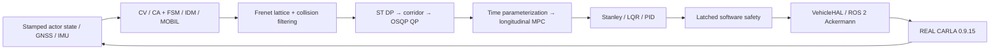
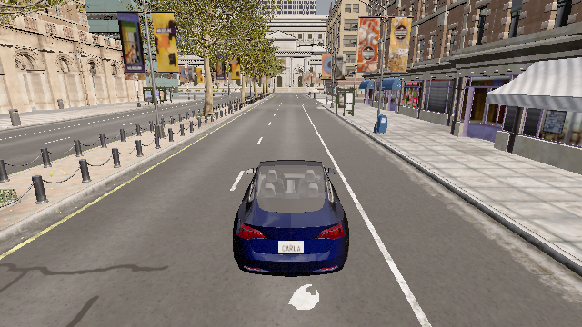
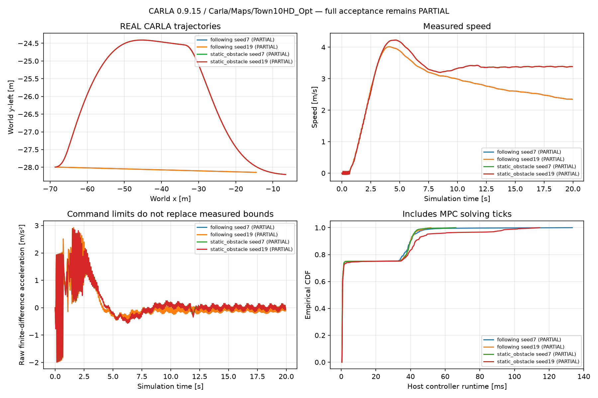

# FalconPlan

Vehicle planning and control engineering that connects classical algorithms, a numerically verified C++17 core, ROS 2 safety transport and **real CARLA 0.9.15 physics**. Current delivery: a verified software stage; physical deployment and Raspberry Pi HIL are **PENDING_HARDWARE**.

中文导航：[基线](docs/BASELINE_AUDIT.md) · [仿真与性能](docs/SIMULATION_BENCHMARK.md) · [硬件准备](docs/HARDWARE_READINESS.md) · [验收报告](docs/FINAL_DELIVERY_REPORT.md) · [面试说明](docs/INTERVIEW_TECHNICAL_GUIDE.md)





[Real simulation GIF](artifacts/carla/static_obstacle_seed7/simulation.gif) · [Analytical dynamics comparison](artifacts/dynamics/comparison.png)



## Implementation and measured evidence

| Layer | Implementation | Verified boundary |
|---|---|---|
| Prediction / behavior | CV/CA, TTC/THW, FSM, IDM, MOBIL | Actor-level truth; no perception claim |
| Planning | Frenet lattice, quartic/quintic, segment collision, dynamic ST projection, DP, corridor, OSQP QP | Unit tests and online real-simulator orchestration |
| Control | PID anti-windup, Stanley, LQR, receding longitudinal MPC | Solver limits and physical plant limits evaluated separately |
| Dynamics | Kinematic RK4, friction-limited dynamic bicycle, delayed first-order actuators | Analytical model experiments separately labeled |
| C++17 | State/command/path structures, PID, Stanley, RK4, nearest-path search, constant jerk, candidate cost / continuous collision / selection, checked C ABI | 9 GoogleTests Release and ASan/UBSan; 1,000 core parity samples, 2,000 planning candidates and 10,000 controller calls |
| Safety | Timestamp expiry, geofence, speed/steering/rate limits, manual, latched software E-stop | Software / simulator stop only |
| Real I/O | CARLA spawn/destroy, sync tick, ground-truth actors, control, collision/RGB/GNSS/IMU | Real 0.9.15 engine; estimator diagnostics separate from control |
| ROS 2 | Humble Ackermann/Odometry, TF, safety services, CARLA bridge, rosbag | Real ROS transport; hardware pending |
| Engineering | Packaging, CPU/RSS profiling, JSONL replay/fault injection, release staging/rollback, CI | CI definitions are not passing badges |

| Checkpoint | Measured result |
|---|---|
| Python inherited baseline | 483 passed |
| Software regression | Windows: **524 passed, 11 native/Linux skips**; WSL: **526 passed** in 6.82 s |
| Python/C++ parity | Seed 42, 1,000 cases, max absolute difference **1.42e-14** |
| DP → QP → MPC analytical demo | Position RMSE **0.0521 m**, speed RMSE **0.0297 m/s**, dense ST check passed |
| CARLA initial PID suite | 7 scenarios × seeds 7/19, 12 s/run, zero collisions after axle-coordinate correction |
| Online CARLA full-chain checkpoint | Following/static displacement **53.97/61.61 m**, CTE RMSE **0.000127/0.0802 m**, zero collisions; physical acceleration acceptance **PARTIAL** |
| Updated manual-gear sensor runs | 4 × 20 s: motion/acceleration passed; actual max acceleration **2.89–2.92 m/s²**, GNSS/IMU position RMSE **0.073–0.104 m**; jerk **78–87 m/s³ remains PARTIAL** |
| C++ in-process full-chain recovery | Following/static seed 7, 20 s each: motion and +3/−6 m/s² acceleration envelope pass, zero collisions; jerk **PARTIAL**, planner P95 **327/87 ms** |
| Final seven-scene raw regression | 14 × 12 s: motion and ideal-sensor diagnostics pass, zero collisions; **14/14 overall PARTIAL**, with measured jerk and some acceleration limits exceeded |
| Real ROS → Safety → CARLA | 802 samples; latency P50/P95/P99 **0.641/0.950/1.350 ms**, timer jitter σ **0.348 ms** |
| Analytical actuator delay | CTE RMSE **0.5876 → 0.3301 m** after gain reduction; 20 m/s low-friction OOD case **FAIL** |

The initial PID acceleration log was clipped and is excluded from physical acceleration claims. Updated runs record raw measurements and command intent separately. Normal final PID scenes exceed the +3 m/s² target; timeout emergency stops reach 23–27 m/s² deceleration and 316–508 m/s³ jerk. Online Python planning runs at 2 Hz; observed P95 can approach 0.5 s. This is synchronous simulator evidence, not a 20 Hz real-time full-stack certification. Latest versioned JSON reports retain tuning failures. The original 16-week acceptance matrix has **9 PASS / 7 PARTIAL (56.25% week-level PASS)**; this is not an estimate of completed engineering effort.

## Setup and reproduction

Python 3.10+; Windows Python 3.11 for algorithms, Ubuntu 22.04 / WSL Python 3.10 for matching CARLA API and ROS Humble.

```bash
python -m pip install -e ".[dev,profiling]"
python -m pytest -q
MPLBACKEND=Agg python -m demos.w07_dp_qp_speed_demo
MPLBACKEND=Agg python -m demos.w07_longitudinal_mpc_demo
python -m demos.dynamics_benchmark
```

The Agg prefix is Bash syntax. In PowerShell set `$env:MPLBACKEND='Agg'` first; omit it for interactive plots.

```bash
# WSL; CARLA 0.9.15 server already running on Windows
python -m pip install -e ".[dev,sim,profiling]"
python -m demos.carla_regression --host WINDOWS_HOST_IP --steps 240 --seeds 7,19
python -m demos.carla_regression --host WINDOWS_HOST_IP --steps 400 --seeds 7,19 \
  --scenarios following,static_obstacle --full-stack --mpc --output artifacts/new_full_stack
python -m demos.carla_actuator_identification --host WINDOWS_HOST_IP --manual-gear
```

Read WSL's default gateway via `ip route` for the host-specific Windows IP. Only one process may own synchronous ticks. Regression returns nonzero for failed/partial acceptance and keeps its logs.

```bash
# Ubuntu: CMake, GCC and libgtest-dev required
cmake -S cpp -B build/cpp -DCMAKE_BUILD_TYPE=Release
cmake --build build/cpp -j4
ctest --test-dir build/cpp --output-on-failure
python -m tools.cpp_parity --probe build/cpp/core_probe
python -m tools.cpp_binding_benchmark --library build/cpp/libfalcon_c.so
cmake -S cpp -B build/asan -DFALCON_SANITIZE=ON -DCMAKE_BUILD_TYPE=Debug
cmake --build build/asan -j4
ctest --test-dir build/asan --output-on-failure
```

[ROS execution scripts](ros2/) · [Commissioning, recording, calibration, replay and rollback](tools/hardware/README.md)

The CARLA driver optionally executes the C++ Stanley kernel in process with `--cpp-lib build/cpp/libfalcon_c.so`. Python remains responsible for the lattice/DP/QP/MPC executive. With `FALCON_PLANNING_CPP_LIBRARY`, C++ also executes candidate cost, continuous collision and selection; polynomial generation, feasibility, ST-DP/QP and MPC remain Python. The scalar FFI benchmark is recorded honestly, including cases where call overhead makes C++ slower than Python.

## Engineering lessons and limitations

CARLA wheel positions are world centimeters: treating them as local axle coordinates caused tens of meters of tracking error. The adapter now projects them into the actor frame and explicitly converts handedness. Real step sweeps identified automatic first-gear clutch acceleration spikes of 12–15 m/s²; manual first gear reduced the same throttle sweep to approximately 2–3 m/s². Raw before/after logs are retained. A native Ackermann-servo experiment also failed with a collision.

Control localization currently uses ground truth. Real GNSS/IMU EKF diagnostics need noise/dropout and feedback validation before a sensor-localized control claim. Circular geometry, lane-selection assumptions, intersections, traffic compliance, perception and a full ODD safety case remain limited. PPO / Stackelberg are P1 work: no trained-policy result is claimed without actual weights and seeded training/evaluation artifacts. R550 steering geometry, protocol and calibration remain unknown. **Hardware-Ready / Pending Physical Validation** describes the software adapter/tooling interface, not a physically validated vehicle.

Native planning reproduction after the C++ build:

```bash
FALCON_PLANNING_CPP_LIBRARY=build/cpp/libfalcon_c.so python -m pytest -q
python -m tools.cpp_planning_benchmark --library build/cpp/libfalcon_c.so
FALCON_PLANNING_CPP_LIBRARY=build/cpp/libfalcon_c.so python -m demos.carla_regression \
  --host WINDOWS_HOST_IP --steps 400 --seeds 7 --scenarios static_obstacle \
  --full-stack --mpc --cpp-lib build/cpp/libfalcon_c.so --output artifacts/new_cpp_planning
```

The C++ cost/collision/selection kernel is actually used by the live planner. Its two-thousand-candidate parity study has maximum cost error 4.55e-13 with no collision/selection mismatch. Full native-enabled WSL regression: **535 passed**; the recorded CARLA integration still returns PARTIAL because physical jerk exceeds its unchanged acceptance limit. Original week-level acceptance is **9/16 (56.25%)**, a count of fully accepted milestone groups, not engineering effort.
